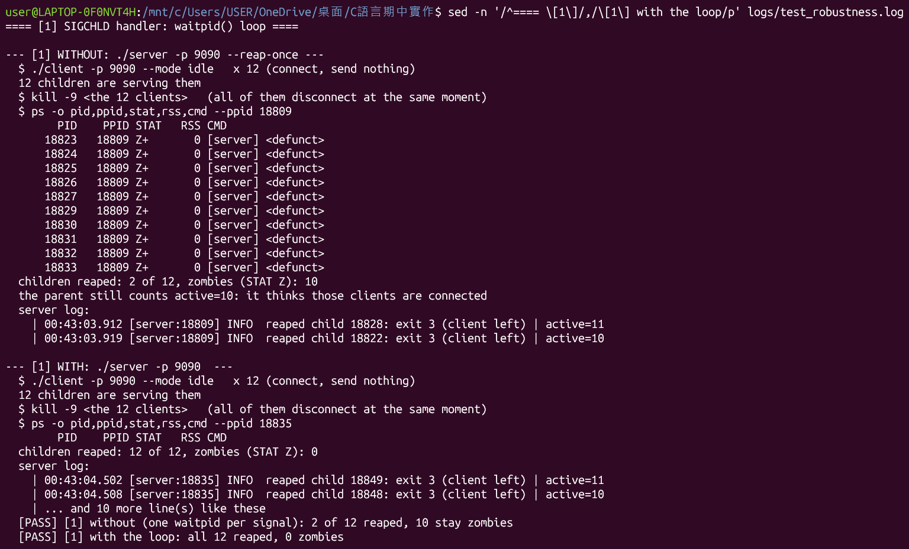
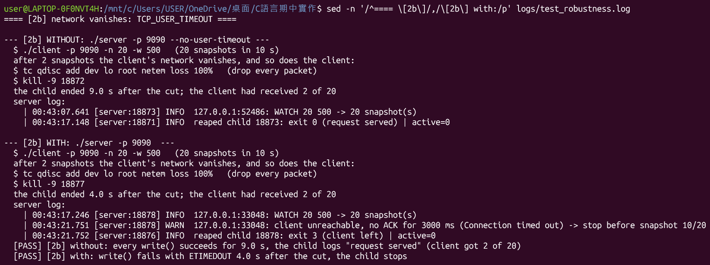
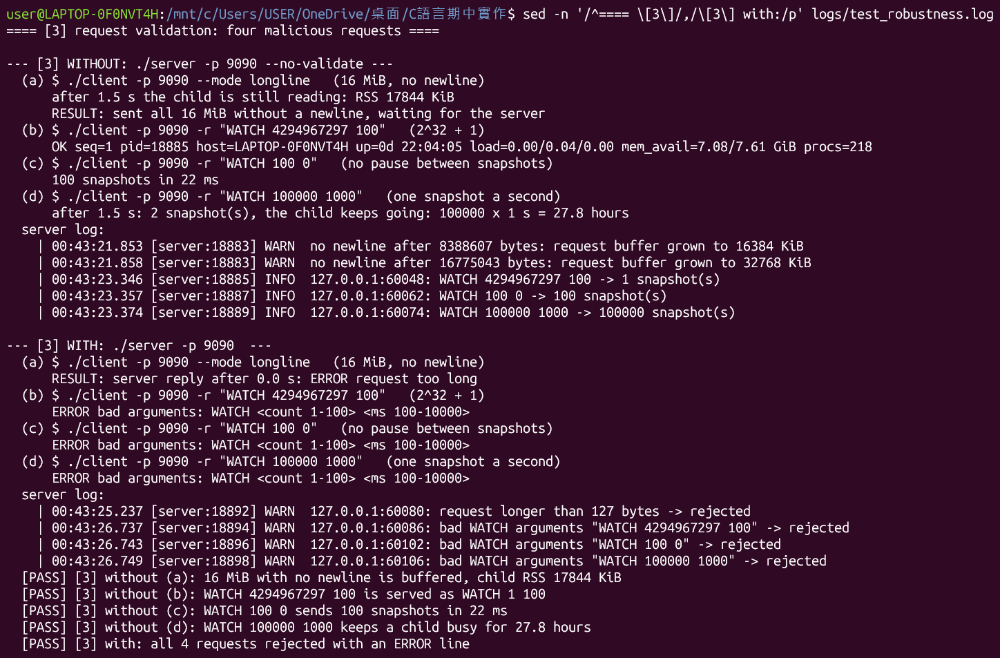
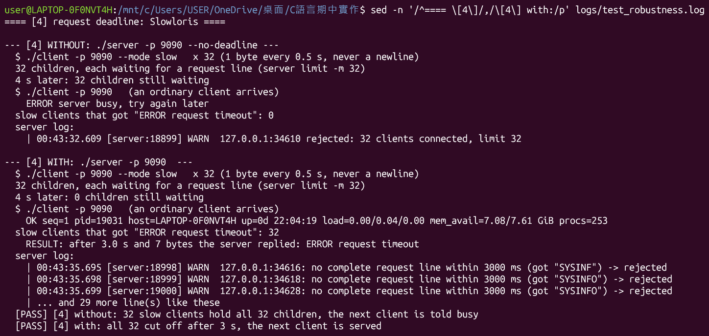
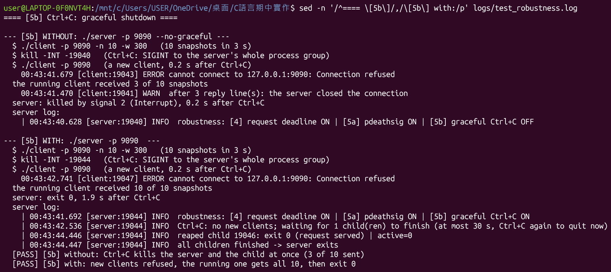
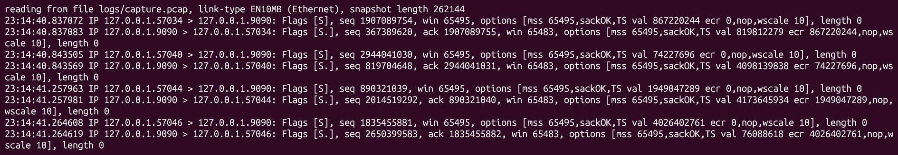
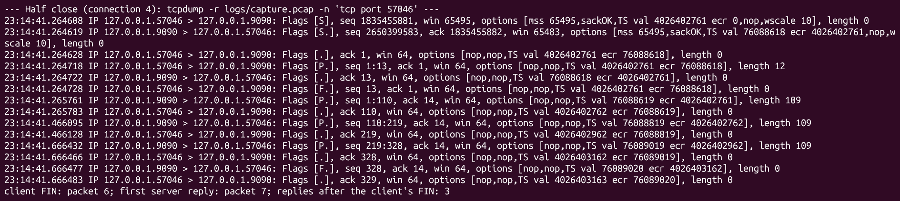

# Execution Screenshots

[← Back to README](../README.md) · [System Design](system-design.md) · [Key Source Code](key-source.md)

Except for the Wireshark window in Section 13 (the capture file opened on Windows), every screenshot was taken from a real run on WSL2 Ubuntu. Above each image is the command that produced it; run it in the project folder to reproduce it. Screenshot 3 starts a server on port 9090, so make sure no other server is running before you run it.

## 1. Build and the shared library

```bash
make clean && make && ldd ./server ./client | grep -E '^\./|libutils'
```

`libutils.so` is compiled with `-fPIC -shared`, and `ldd` shows that the server and the client both link to it dynamically.


## 2. 12 concurrent clients (fork-based multi-process)

```bash
make demo
```

The 12 clients each send a different request, from `WATCH 2 3000` to `WATCH 31 100`, and every connection lasts 3 seconds. 12 children exist at the same time (all with the parent as their PPID), the 12 clients are served by 12 different PIDs, and each receives the number of snapshots it asked for; the bad requests get `ERROR`, and no zombie processes are left at the end.


## 3. Two-level debug: runtime

```bash
./server -d 2 & sleep 0.3; ./client; sleep 0.2; kill $!
```

`-d 2` shows `file:line` and hex dumps; the request starts with `53 59 53 49 4e 46 4f` (`SYSINFO`).


## 4. Two-level debug: compile time

```bash
tail -n 24 logs/test_debug.log
```

The release build has 0 debug strings and no logger calls inside `write_all()`; the number of output lines grows with the `-d` level.


## 5. With/Without [1]: 12 clients disconnect at once

```bash
sed -n '/^==== \[1\]/,/\[1\] with the loop/p' logs/test_robustness.log
```

12 `--mode idle` clients connect and are then killed together with `kill -9`, so 12 children exit almost at the same moment. Signals do not queue, so the parent receives SIGCHLD only a few times. Without (`--reap-once`, one `waitpid` call per SIGCHLD) reaps only 2; the other 10 stay in state `Z` and the parent's count stays at `active=10`. With reaps them all in one loop, all 12.



## 6. With/Without [2]: the client leaves midway

### 6.1 [2a] The client closes normally (SIGPIPE)

```bash
sed -n '/^==== \[2a\]/,/\[2a\] both/p' logs/test_robustness.log
```

Without, signal 13 kills the child; With, the child detects `EPIPE` and exits normally with code 3. In both cases the parent keeps serving.


### 6.2 [2b] The client's network suddenly vanishes (TCP_USER_TIMEOUT)

```bash
sed -n '/^==== \[2b\]/,/\[2b\] with:/p' logs/test_robustness.log
```

After the client receives 2 snapshots, `tc qdisc add dev lo root netem loss 100%` drops every packet on the loopback, and the client vanishes with it. Without, every `write()` succeeds, the child "sends" for another 9 seconds and finally logs `exit 0 (request served)`; With, `write()` returns `ETIMEDOUT` 4.0 seconds after the cut, and the child logs `client unreachable` and stops. The test runs `tc` inside its own network namespace, so it needs no root and does not affect the system's network.



## 7. With/Without [3]: four malicious requests

```bash
sed -n '/^==== \[3\]/,/\[3\] with:/p' logs/test_robustness.log
```

The same server receives 4 requests in turn: (a) 16 MiB with no newline, (b) `WATCH 4294967297 100`, (c) `WATCH 100 0`, (d) `WATCH 100000 1000`. Without, all 4 are accepted: (a) the buffer doubles up to 32 MiB and the child's RSS is about 17 MiB; (b) 4294967297 overflows to 1, and the log records `-> 1 snapshot(s)`; (c) 100 lines go out within 22 ms; (d) this request would run for 27.8 hours. With, all 4 get `ERROR`.

The buffer is allocated at 32 MiB, but only 16 MiB of it is actually written; Linux gives no physical memory to the part that was never written, so the RSS is about 17 MiB.



## 8. With/Without [4]: Slowloris

```bash
sed -n '/^==== \[4\]/,/\[4\] with:/p' logs/test_robustness.log
```

32 `--mode slow` clients each send 1 byte every 0.5 seconds and never send a newline, filling the server's default 32 slots. 4 seconds later a normal client arrives. Without, the 32 children are still waiting and the normal client gets `ERROR server busy`; With, the 32 get `ERROR request timeout` at the 3-second mark (in 3 seconds each has sent only 7 bytes, not even all of `SYSINFO`), and the normal client is served.



## 9. With/Without [5]: the server ends

### 9.1 [5a] The parent gets `kill -9`

```bash
sed -n '/^==== \[5a\]/,/\[5a\] with:/p' logs/test_robustness.log
```

Without, the child becomes an orphan (its PPID changes) and sends all 10 snapshots; With, the child exits along with the parent, and the client receives only 3.


### 9.2 [5b] `Ctrl+C`

```bash
sed -n '/^==== \[5b\]/,/\[5b\] with:/p' logs/test_robustness.log
```

The test puts the server in its own process group and simulates `Ctrl+C` with `kill -INT -<pgid>`. Without, signal 2 kills the server and its child together, and the client receives only 3 snapshots; With, new clients are refused at once (connection refused), the client being served receives all 10, and the server exits with code 0 after its child finishes.



## 10. Summary of the seven With/Without pairs

```bash
sed -n '/With \/ Without summary/,$p' logs/test_robustness.log
```


## 11. tcpdump capture: one connection from start to finish

```bash
tcpdump -r logs/capture.pcap -n -c 10
```

The first connection the test captured (`SYSINFO`): the three-way handshake (`[S]`, `[S.]`, `[.]`), the 8-byte request, the 109-byte reply, and finally one FIN from each side (`[F.]`).


## 12. Header analysis of the request packet

```bash
sed -n '/Bytes of the request packet/,/payload (8 bytes)/p' logs/test_capture.log
```

The test reads the pcap file directly and breaks the request packet into Ethernet (14 bytes), IPv4 (20 bytes), TCP (32 bytes) and the payload (`SYSINFO\n`), explaining each field. The IPv4 part includes type of service and fragment offset; the TCP part includes data offset, reserved, the 6 flag bits (`URG 0 ACK 1 PSH 1 RST 0 SYN 0 FIN 0`), the window size after multiplying by the window scale (64 × 2^10 = 65536 bytes), the urgent pointer, and the options (NOP, NOP, timestamps).


## 13. Wireshark packet analysis

Open `logs/capture.pcap` in Wireshark, enter the display filter `tcp.port == 9090`, right-click packet 4 (`[PSH, ACK]`, Len=8) and choose Follow → TCP Stream. Wireshark changes the filter to `tcp.stream eq 0` and keeps only the 10 packets of the first connection, which match the tcpdump output above; in the lower pane, the red text is the `SYSINFO` the client sent and the blue text is the `OK seq=1 ...` the server sent back.


## 14. tcpdump filter for SYN packets

```bash
tcpdump -r logs/capture.pcap -n 'tcp[13] & 2 == 2'
```

`tcp[13]` is byte 13 of the TCP header, which holds the flags; `& 2` picks out the SYN bit. The capture file has 4 connections, so only 8 packets remain: one `[S]` and one `[S.]` for each connection. The SYN packets carry options such as MSS, SACK permitted, timestamp and window scale.



## 15. Half close

```bash
sed -n '/Half close (connection 4)/,/replies after/p' logs/test_capture.log
```

Connection 4 is `./client -n 3 -w 200 --half-close`. After sending `WATCH 3 200` (length 12), the client calls `shutdown(fd, SHUT_WR)`; packet 6 is the client's `[F.]`, and at that point the server has not replied yet. After that the server still sends one line every 200 ms (packets 7, 9 and 11, 109 bytes each) and sends its own `[F.]` only when it is done. The two directions of a TCP connection can be closed separately: the client no longer sends data, but it can still receive.


