# 執行截圖（Execution Screenshots）

[← 回到 README](../README.md) ・ [系統設計說明](system-design.md) ・ [關鍵原始碼說明](key-source.md) ・ [稽核討論](audit.md)

以下都是在 WSL2 Ubuntu 上實際執行的畫面。每張圖上方是產生該畫面的指令，在專案資料夾執行即可重現。

## 1. 建置與動態函式庫

```bash
make clean && make && ldd ./server ./client | grep -E '^\./|libutils'
```

`libutils.so` 以 `-fPIC -shared` 編譯，`ldd` 顯示 server 和 client 都動態連結到它。

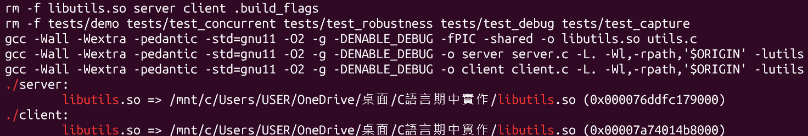

## 2. 12 個 client 併發（fork 多程序）

```bash
make demo
```

12 個 child 同時存在（PPID 都是 parent），12 個 client 由 12 個不同的 PID 服務，錯誤的請求收到 `ERROR`，結束後沒有殭屍程序。

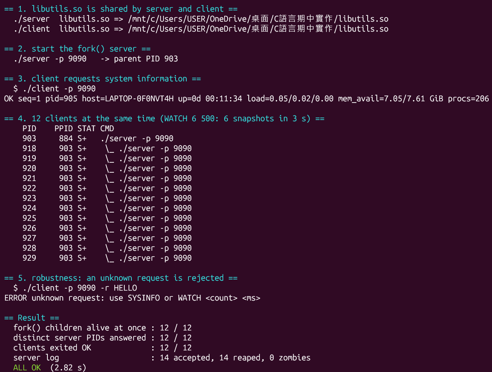

## 3. 雙層 Debug：執行期

```bash
./server -d 2 & sleep 0.3; ./client; sleep 0.2; kill $!
```

`-d 2` 會顯示 `file:line` 和 hex dump，請求開頭是 `53 59 53 49 4e 46 4f`（`SYSINFO`）。

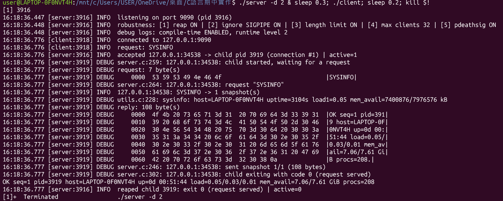

## 4. 雙層 Debug：編譯期

```bash
tail -n 24 logs/test_debug.log
```

release 版的 debug 字串為 0 個，`write_all()` 內也沒有 logger 呼叫；輸出行數隨 `-d` 等級增加。

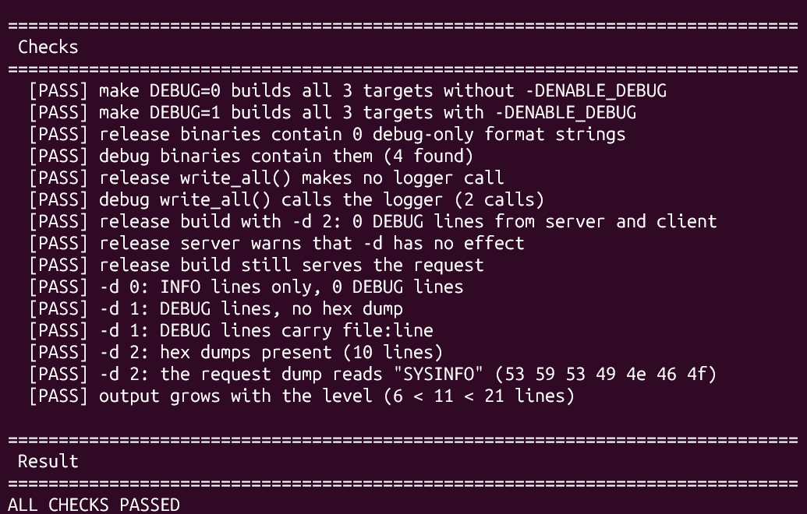

## 5. With/Without [1]：殭屍程序

```bash
./server --no-sigchld 2>/dev/null & sleep 0.3; for i in 1 2 3; do ./client >/dev/null 2>&1; done; sleep 0.3; ps -o pid,ppid,stat,cmd --ppid $!; kill $!
```

```bash
./server 2>/dev/null & sleep 0.3; for i in 1 2 3; do ./client >/dev/null 2>&1; done; sleep 0.3; ps -o pid,ppid,stat,cmd --ppid $!; kill $!
```

Without 留下 3 個 `Z` 狀態的 `<defunct>`，With 沒有任何殘留的 child。

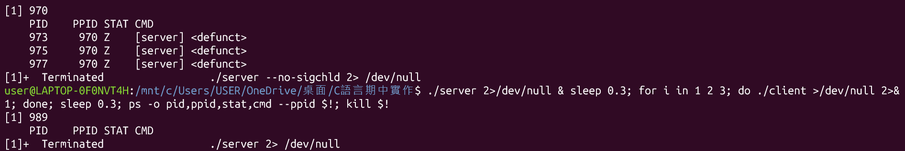

## 6. With/Without [2]：client 中途離開（SIGPIPE）

```bash
sed -n '/^==== \[2\]/,/both: the next client/p' logs/test_robustness.log
```

Without 時 child 被 signal 13 殺掉，With 時 child 偵測 `EPIPE` 後以 exit 3 正常結束；兩種情況下 parent 都能繼續服務。

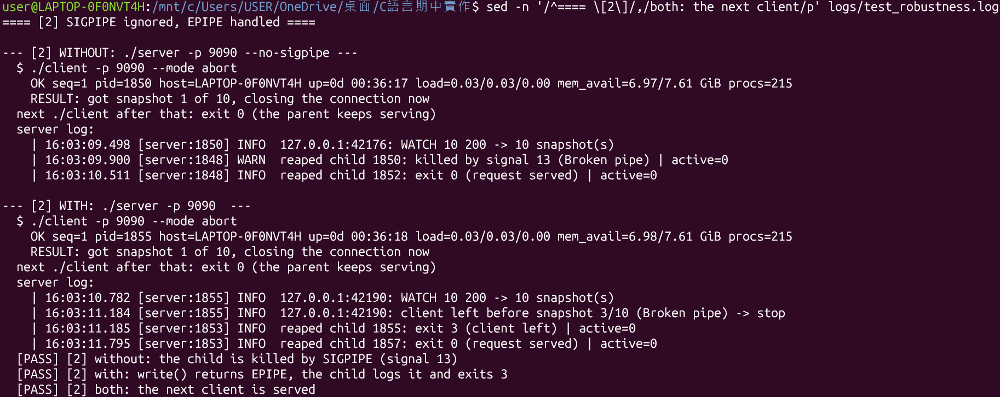

## 7. With/Without [3]：不換行的超長請求

```bash
sed -n '/^==== \[3\]/,/with: rejected after/p' logs/test_robustness.log
```

Without 時緩衝區一路加倍到 32 MiB，child 的 RSS 約 17 MiB；With 時讀到 127 bytes 就回 `ERROR request too long`。

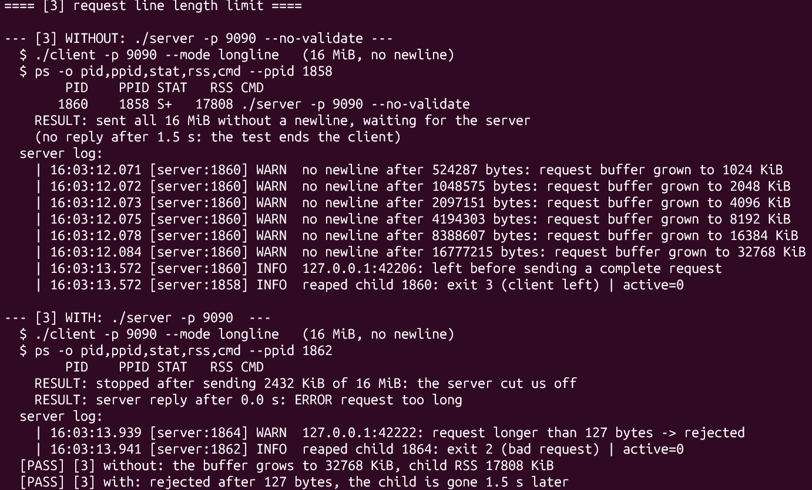

## 8. With/Without [4]：連線上限

```bash
sed -n '/^==== \[4\]/,/with -m 5:/p' logs/test_robustness.log
```

Without 時 10 個閒置 client 佔住 10 個 child；With（`-m 5`）時只有 5 個 child，另外 5 個 client 立刻收到 `ERROR server busy`。

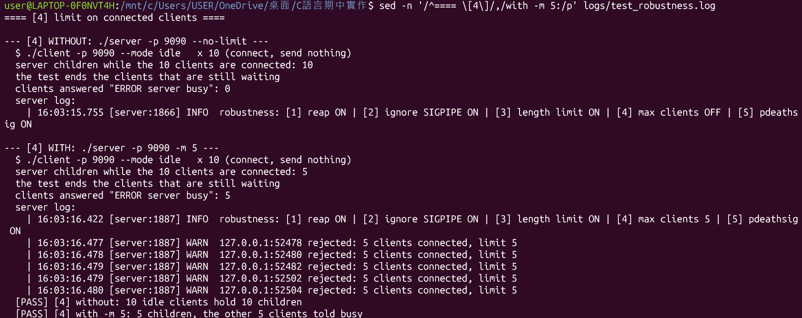

## 9. With/Without [5]：parent 被 `kill -9`

```bash
sed -n '/^==== \[5\]/,/with: the child ends/p' logs/test_robustness.log
```

Without 時 child 變成孤兒（PPID 改變）並把 10 筆送完；With 時 child 跟著 parent 結束，client 只收到 3 筆。

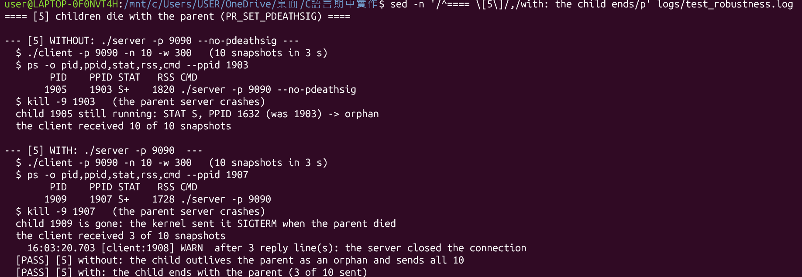

## 10. 五組 With/Without 總表

```bash
sed -n '/With \/ Without summary/,$p' logs/test_robustness.log
```

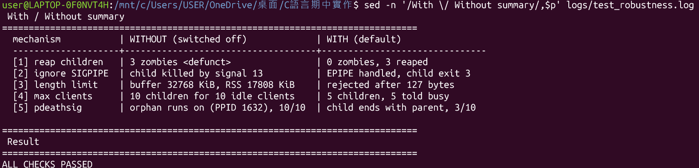

## 11. tcpdump 抓包：一條連線的完整過程

```bash
tcpdump -r logs/capture.pcap -n -c 10
```

三向交握（`[S]`、`[S.]`、`[.]`）、8 bytes 的請求、107 bytes 的回應，最後雙方各送一次 FIN（`[F.]`）。

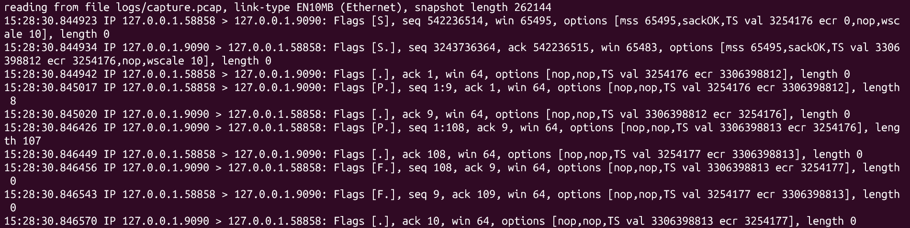

## 12. 請求封包的標頭分析

```bash
sed -n '/Bytes of the request packet/,/payload (8 bytes)/p' logs/test_capture.log
```

測試程式直接讀 pcap 檔，把請求封包拆成 Ethernet（14 bytes）、IPv4（20 bytes）、TCP（32 bytes）和 payload（`SYSINFO\n`），逐欄說明。

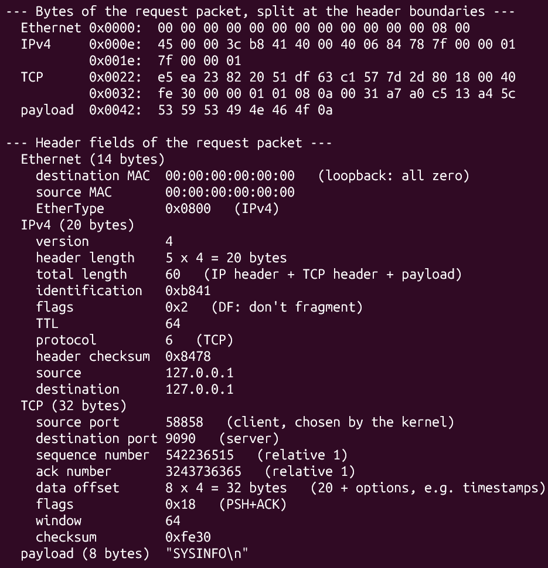

## 13. Wireshark 封包分析

用 Wireshark 開啟 `logs/capture.pcap`，display filter 輸入 `tcp.port == 9090`，對第 4 個封包（`[PSH, ACK]`，Len=8）按右鍵選 Follow → TCP Stream。Wireshark 會把 filter 換成 `tcp.stream eq 0`，只留下第一條連線的 10 個封包，和上一張 tcpdump 的結果一致；下方視窗紅字是 client 送的 `SYSINFO`，藍字是 server 回的 `OK seq=1 ...`。

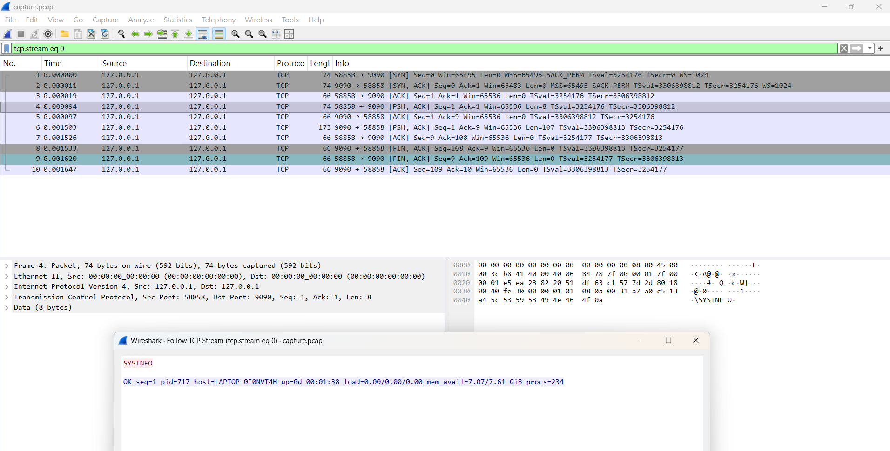

## 14. Real Test：Windows client 連到 WSL2 的 server

WSL 終端機：

```bash
./server -d 1
```

Windows PowerShell，IP 換成在 WSL 用 `hostname -I` 查到的位址：

```powershell
.\win_client.exe 172.17.107.87 9090 "WATCH 3 500"
```

兩張圖是同一次連線。client 端顯示自己的位址是 Windows 的 `172.17.96.1:57920`，server log 的 `accepted 172.17.96.1:57920 -> child pid 3992` 是同一條連線，不是 `127.0.0.1`。3 行回覆間隔約 500 ms，`pid=3992` 都是同一個 child，最後 child 以 exit 0 結束並被回收。

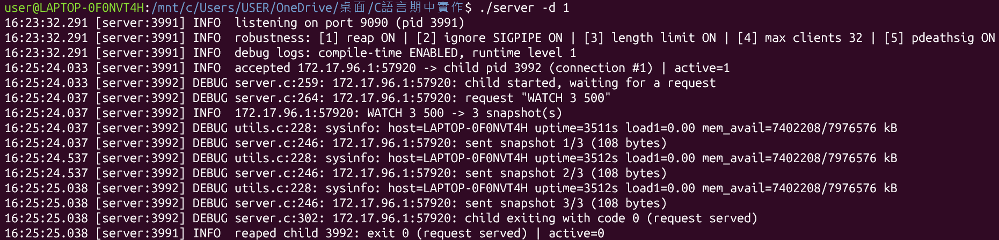

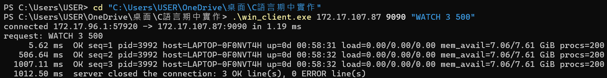

## 15. Real Test 的 Wireshark 抓包

用 Wireshark 開啟 `logs/real_test.pcapng`（共 34 個封包、3 條連線），display filter 輸入 `tcp.stream eq 0`，只看第一條連線（`SYSINFO`）的 10 個封包：三向交握、8 bytes 的請求、108 bytes 的回應，以及雙方的 FIN。來源和目的地是 `172.17.96.1` 和 `172.17.107.87`。選第 4 個封包（`[PSH, ACK]`，Len=8），下方的 Ethernet II 位址是 Hyper-V 虛擬網卡（`00:15:5d:...`），表示封包走的是虛擬網路，不是 loopback；右邊的 hex 結尾是 `53 59 53 49 4e 46 4f 0a`（`SYSINFO\n`）。

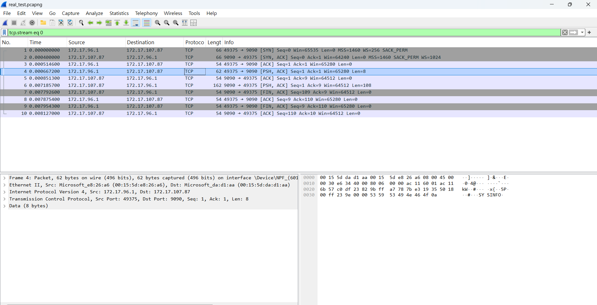
