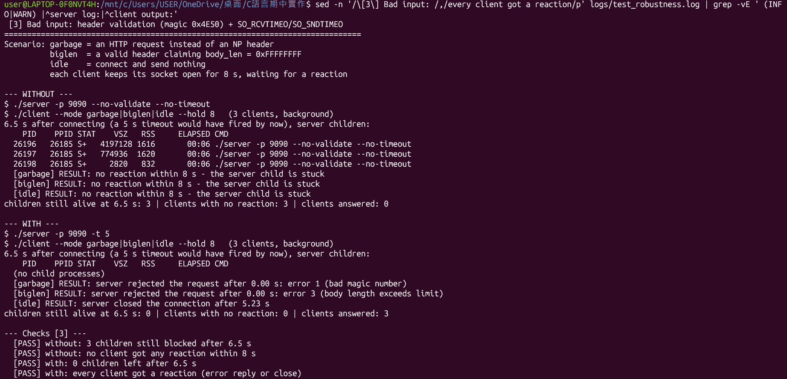
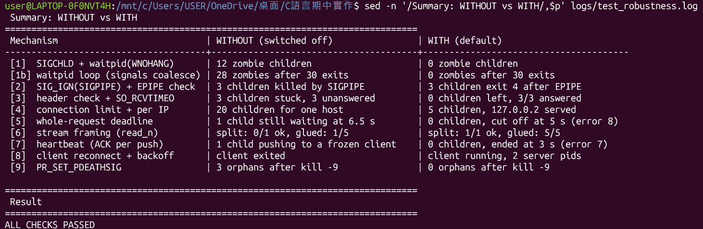
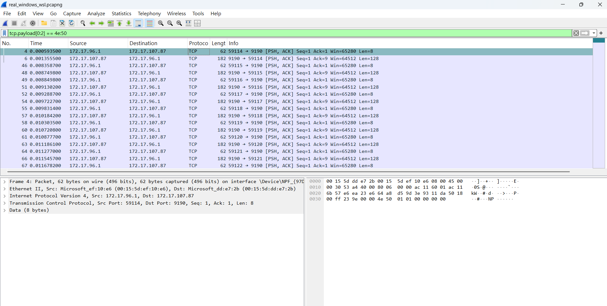
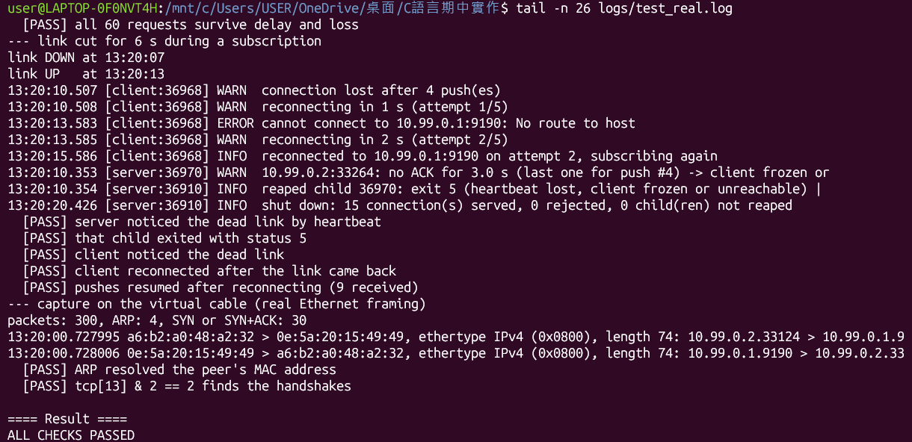
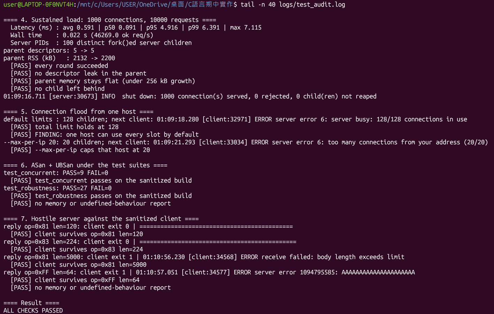

# 執行截圖（Execution Screenshots）

[← 回到 README](../README.md) ・ [系統設計說明](system-design.md) ・ [關鍵原始碼說明](key-source.md)

以下都是在 WSL2 Ubuntu 與 Windows 上實際執行的畫面。

## 1. 建置與動態函式庫

```bash
make clean && make && ldd ./server ./client | grep -E '^\./|libutils'
```

`libutils.so` 以 `-fPIC -shared` 編譯，`ldd` 顯示 server 和 client 都動態連結到它。


## 2. 12 個 client 併發（fork 多程序）

```bash
make demo
```

12 個 child 同時存在，12 個 client 由 12 個不同的 PID 服務，結束後沒有殭屍程序。


## 3. 雙層 Debug：執行期

```bash
./server -p 9094 -d 2 & sleep 0.3; ./client -p 9094 -q; sleep 0.2; kill $!
```

`-d 2` 會顯示 `file:line`、解碼後的 header 和 hex dump，可以看到開頭的 `4e 50`（`NP`）。


## 4. 雙層 Debug：編譯期

```bash
tail -n 32 logs/test_debug.log
```

release 版的 debug 字串為 0 個，`proto_send()` 內也沒有 logger 呼叫；輸出行數隨 `-d` 等級增加。


## 5. With/Without 範例一：殭屍程序

```bash
./server -p 9091 --no-sigchld 2>/dev/null & sleep 0.3; for i in $(seq 12); do ./client -p 9091 -q >/dev/null; done; sleep 0.5; ps -C server -o pid,ppid,stat,cmd; kill $!
```

```bash
./server -p 9092 2>/dev/null & sleep 0.3; for i in $(seq 12); do ./client -p 9092 -q >/dev/null; done; sleep 0.5; ps -C server -o pid,ppid,stat,cmd; kill $!
```

Without 留下 12 個 `<defunct>`，With 只剩 parent。


## 6. With/Without 範例二：client 斷線（SIGPIPE）

```bash
sed -n '/\[2\] SIGPIPE: /,/keeps serving new clients/p' logs/test_robustness.log
```

Without 時 3 個 child 被 signal 13 殺掉，With 時 3 個 child 偵測 `EPIPE` 後以 exit 4 正常結束。


## 7. With/Without 範例三：亂碼、偽造長度、連上不說話

```bash
sed -n '/\[3\] Bad input: /,/every client got a reaction/p' logs/test_robustness.log | grep -vE ' (INFO|WARN) |^server log:|^client output:'
```

Without 時 3 個 child 卡住，偽造長度的 child 虛擬記憶體約 4 GiB；With 時前兩者立即被拒，閒置的連線約 5 秒後被關閉。



## 8. 10 組 With/Without 總表

```bash
sed -n '/Summary: WITHOUT vs WITH/,$p' logs/test_robustness.log
```



## 9. Wireshark 封包分析

用 Wireshark 開啟 `logs/real_windows_wsl.pcapng`，display filter 輸入 `tcp.payload[0:2] == 4e:50`。Windows（`172.17.96.1`）送出 8 bytes 的請求，WSL2（`172.17.107.87`）回應 128 bytes，封包內容可以看到 `NP`。



## 10. Real Test

```bash
tail -n 26 logs/test_real.log
```

模擬斷線 6 秒時，server 靠心跳發現斷線，client 在網路恢復後重連成功。全程只用一台實體電腦，Windows ↔ WSL2 是真實連線，延遲、掉包和斷線是模擬的。



## 11. 稽核

```bash
tail -n 40 logs/test_audit.log
```

長時間負載沒有檔案描述元洩漏，ASan/UBSan 沒有錯誤報告，惡意 server 也無法讓 client 當掉。


