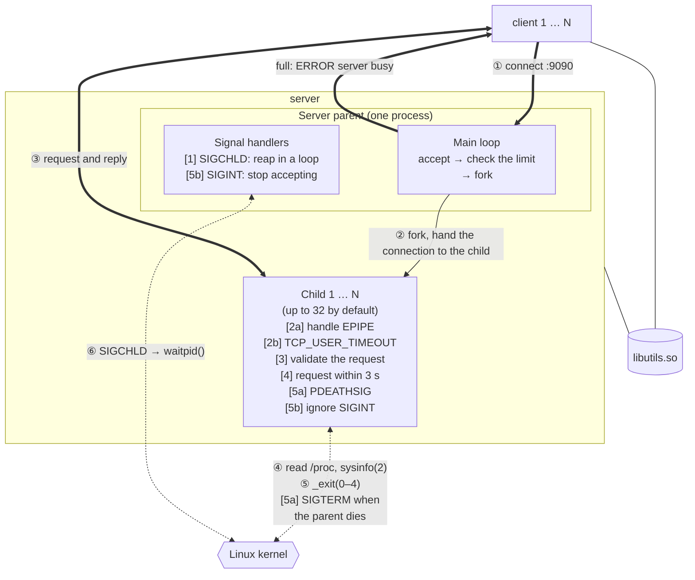
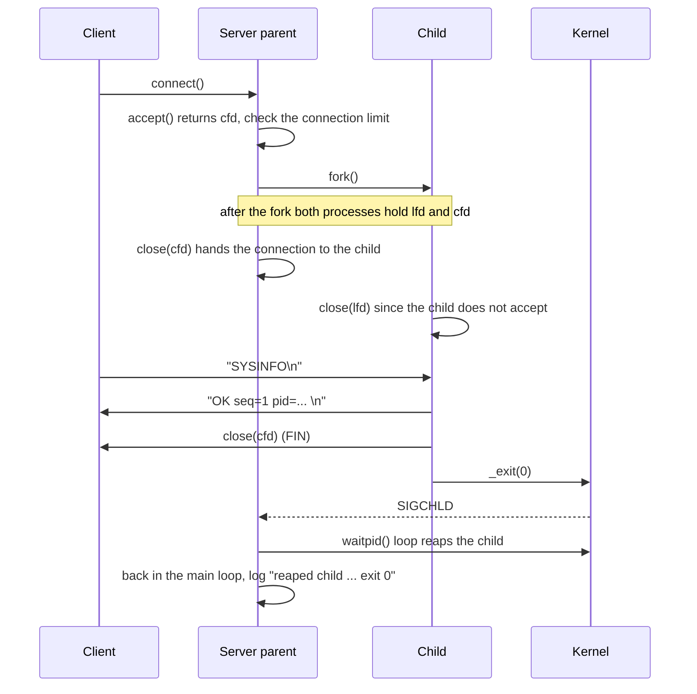

# System Design Explanation

[← Back to README](../README.md) · [Key Source Code](key-source.md) · [Execution Screenshots](screenshots.md)

## 1. Use Case and Goals

When you manage several Linux hosts, you often need a quick look at each host's load and memory. With the **server** running on a host, other people can use the **client** to query it once, or watch it change over a few seconds, without logging in to the host.

| Goal | How the design meets it | How it is verified |
|---|---|---|
| Several clients query at once without affecting each other (at least 10) | Each connection gets its own `fork()`ed child (up to 32 by default), and an error in one child does not affect the parent or the other connections | `test_concurrent`: 12 clients send different `WATCH` requests at once, `ps` shows 12 children, and the 12 clients receive 12 different `pid=` values ([README 6.1](../README.md#61-test_concurrent-12-concurrent-clients)) |
| Do not crash on failures, and leave no zombie or orphan processes | 7 robustness mechanisms that handle five kinds of failure: child reaping, broken connections, malicious requests, slow connections, and the server ending | `test_robustness`: each mechanism runs once off and once on, and the two results are compared ([README 6.2](../README.md#62-test_robustness-seven-withwithout-comparisons)) |
| The effect of every protection can be seen | Each mechanism can be turned off with a flag, so the difference with and without it can actually be compared | Same as above: one test runs all 7 comparisons automatically, and the results are collected in `logs/test_robustness.log` |
| Problems can be traced | Two-level debug: compile time decides whether there is any debug code, runtime decides how much is printed | `test_debug`: no debug strings can be found in the release executables; the debug build handles one `SYSINFO` with `-d 0/1/2`, and the log has 7, 12 and 22 lines respectively ([README 6.3](../README.md#63-test_debug-two-level-debug)) |

The point-by-point mapping of the midterm requirements to this project is in [README Requirements Mapping](../README.md#requirements-mapping).

## 2. System Architecture

**Legend:** Thick lines are data over TCP, thin solid lines are `fork()`, dashed lines are interactions with the kernel (reading system information, process exit, signals, reaping), and lines without arrows are dynamic linking. ① to ⑥ give the order of events on one connection; [1] to [5b] are the robustness mechanisms of [Section 5](#5-robustness-design), each placed on the process responsible for it.

### Process Model

| Role | Responsibilities | What it does not do |
|---|---|---|
| **Parent** | `accept()`, check the connection limit, `fork()`, reap children, write the log; on `Ctrl+C`, wait for the children to finish before exiting | Does not read client data; writes only the one line `ERROR server busy` when the limit is reached |
| **Child** | Read one request line, validate it, reply, `_exit(reason code)` | Does not accept (it closes the listening socket right after the fork); ignores `Ctrl+C` and lets the parent decide when to end |

The project uses no threads anywhere.

### Data Flow

Once the connection is handed to the child, requests and replies travel only **between the client and the child**. When the child exits, the kernel sends **SIGCHLD**, and the parent reaps the child with **`waitpid()`** and records its exit code, so no zombie processes are left.

### Shared Library

The client and the server both link **`libutils.so`** dynamically: the logger, `write_all`, `read_line`/`read_line_timeout`, and system information collection and formatting. The server's reply is produced by `sysinfo_format()`, and the client reads it back with `read_line()` and prints it as it is.

## 3. Execution Flow

The two `close()` calls leave each connection held by exactly one process: the parent keeps only the listening socket and the child keeps only its own connection, so the parent's fd count does not grow with the number of clients it has served. `ls -l /proc/<pid>/fd` shows which sockets the parent and each child hold.

### Requests and Replies

| Client sends | Server replies |
|---|---|
| `SYSINFO` | One line `OK seq=1 pid=... host=... up=... load=... mem_avail=... procs=...` |
| `WATCH <count> <ms>` | One line every `<ms>` milliseconds, `<count>` lines in total (count 1–100, ms 100–10000) |
| A bad request | One line `ERROR <reason>`, then the connection is closed |

Each connection handles one request. The `pid=` in the reply is the child that handles this connection, so a packet capture and the client's output both show directly which process served it.

The fields of the `OK` line are listed below; each line of a `WATCH` reads them again:

| Field | Meaning | Format | Source |
|---|---|---|---|
| `seq` | Which reply line this is on the connection: always 1 for `SYSINFO`, counting from 1 to count for `WATCH` | Integer | The child's loop counter |
| `pid` | The child that handles this connection | Integer | `getpid()` |
| `host` | Host name | String; `unknown` if it cannot be read | `gethostname()` |
| `up` | Time since boot | Days and hh:mm:ss, for example `0d 00:00:30` | `uptime` from `sysinfo(2)` |
| `load` | Load average over 1, 5 and 15 minutes | Three decimals separated by `/` | `getloadavg()` |
| `mem_avail` | Available memory / total memory | GiB, two decimal places | `MemAvailable` and `MemTotal` in `/proc/meminfo`; estimated from `sysinfo(2)` if they cannot be read |
| `procs` | Total number of tasks on the host | Integer | `procs` from `sysinfo(2)` |

`procs` is not the number of processes: the kernel counts every thread (kernel threads included) as a task, so it is larger than the number of processes `ps` lists. It equals the total after the `/` in the 4th field of `/proc/loadavg`.

### Parent Main Loop

The parent repeats "**print the reap records → `accept()` → check the limit → `fork()`**". When SIGCHLD interrupts `accept()`, it returns `EINTR`; the parent goes back to the top of the loop, first writes the children it just reaped to the log, and then waits again. After `Ctrl+C` it leaves the loop and exits only when every child has finished ([5b]).

### Child Request Handling

The child reads one request line (at most 127 bytes, which must arrive within 3 seconds), decides whether it is `SYSINFO`, `WATCH` or an error, replies, and exits. The exit code gives the reason it ended, and the parent writes it to the log when it reaps the child:

| Exit code | Reason |
|---|---|
| 0 | Request served |
| 1 | I/O error |
| 2 | Request rejected (too long, unknown command, bad arguments) |
| 3 | The client is already gone (it disconnected before finishing the request, or a write got `EPIPE`), or the network is down and the client cannot be reached (`ETIMEDOUT`) |
| 4 | Request timed out: a line was not finished within 3 seconds |

## 4. Two-Level Debug

| Level | Decided by | Effect |
|---|---|---|
| Compile time | `make` (`-DENABLE_DEBUG`) or `make release` | The release build has the debug code and strings removed entirely, so they cost nothing at runtime |
| Runtime | `-d 0/1/2` | 0 normal messages only, 1 adds the program flow (with `file:line`), 2 also adds hex dumps of the request and the reply |

Both levels are needed: production uses the release build, with no extra overhead at all; development uses the debug build and turns the output on with `-d` only when it is needed, without recompiling.

## 5. Robustness Design

7 mechanisms handle five kinds of failure, and each mechanism can be turned off with a flag to compare the results with and without it.

| Kind of failure | What happens | Mechanism | Flag to turn it off |
|---|---|---|---|
| Child reaping: 12 children exit at once | Signals do not queue, and code that reaps only once per signal leaves zombies | [1] A `waitpid` loop in the SIGCHLD handler | `--reap-once` |
| Connection: the client closes normally | SIGPIPE kills the child while it writes | [2a] Ignore SIGPIPE and handle `EPIPE` | `--no-sigpipe` |
| Connection: the client's network suddenly vanishes | No FIN or RST arrives, `write()` keeps succeeding, and the child sends data into thin air | [2b] A 3-second `TCP_USER_TIMEOUT` | `--no-user-timeout` |
| Input: malicious requests | Memory grows without limit, numbers overflow, a 0 ms flood, a 27.8-hour request | [3] A length limit, `%3d %5d`, and range checks | `--no-validate` |
| Slow connections: Slowloris | 32 slow connections fill every slot, and normal clients cannot get in | [4] The whole request line must arrive within 3 seconds | `--no-deadline` |
| Server ending: the parent gets `kill -9` | The children become orphans with nobody managing them | [5a] `PR_SET_PDEATHSIG` | `--no-pdeathsig` |
| Server ending: `Ctrl+C` | Clients being served are cut off along with the server | [5b] Stop accepting and wait for the children to finish | `--no-graceful` |

**They come in pairs:** Of [1] and [5a], one is "the child died and the parent did not reap it" (a zombie) and the other is "the parent died and the child lives on" (an orphan); together they guarantee that a child's lifetime always follows the parent's. [2a] and [2b] are both a client leaving midway; they differ in whether the client gets the chance to tell the server. [5a] and [5b] are both the server ending: in one it is killed, in the other someone asks it to stop; when [5b] waits too long, [5a] takes care of the remaining children.

The connection limit (`-m`, default 32) is a regular feature, not one of the 7 mechanisms: it can only limit the number of children and cannot stop Slowloris, which is why [4] is also needed.

**What [4] cannot cover:** [4] only applies until the request has been sent. When the request itself is valid, for example `WATCH 100 10000`, the child sends for 99 × 10 seconds, about 16.5 minutes; if one machine sends 32 such requests, every slot is still taken and everyone else gets only `ERROR server busy`. This is not handled yet, and it is listed among the limitations in [Section 6](#6-design-trade-offs-and-limitations).

The measured comparisons are in [README 6.2](../README.md#62-test_robustness-seven-withwithout-comparisons). There, [2b] is set to 3 seconds, but the child actually stops 4.0 seconds after the cut: the 3 seconds start when the first data that gets no ACK is sent, and since the child sends only every 0.5 seconds, the timer starts only when the next snapshot goes out after the cut; after the timeout, the child also gets `ETIMEDOUT` only at its next `write()`.

## 6. Design Trade-offs and Limitations

| Decision | Benefit | Cost |
|---|---|---|
| Fork one child per connection | Good isolation: one child crashing does not affect the other connections; the code is simple | One process per connection uses more resources than a thread, so `-m` limits the number (default 32) |
| Two 3-second deadlines ([2b], [4]) | Disconnected and slow clients are dropped quickly, so their slots come back | A normal client on a very bad network (for example one cut off for more than 3 seconds) is cut off too; making them longer means changing the constants in `server.c` and recompiling |
| Requests and replies are one line of plain text | They can be read directly in a packet capture and tested with `telnet` or `nc` | Numbers sent as text take a few more bytes than a binary format |
| One request per connection | The child's flow is simple: it ends as soon as it is done | Every query needs a new three-way handshake |
| The signal handler only records; the main loop prints the log | Avoids calling the unsafe `printf()` inside a handler | A reap record may not be printed until the next time `accept()` returns |

**Other limitations:**

- Linux and IPv4 only.
- No encryption or authentication; anyone who can reach the server can read the system information.
- Valid long requests can fill every slot: 32 `WATCH 100 10000` requests make other clients get `ERROR server busy` for about 16.5 minutes. Such a request also lasts longer than the 30 seconds [5b] waits, so it is cut off after `Ctrl+C`. Further protection could limit the number of simultaneous connections from one IP, or the total time of each request ((count − 1) × ms).
- When `fork()` fails, the parent only logs the error and closes the connection, and the client receives no reply at all (the client exits with code 2).
- The client has no timeout: if the server neither replies nor closes the connection, the client waits until the user presses `Ctrl+C`.
- The 3 seconds ([2b], [4]), the 30 seconds ([5b]) and the `WATCH` ranges are constants in the code; no command-line flag can change them.
