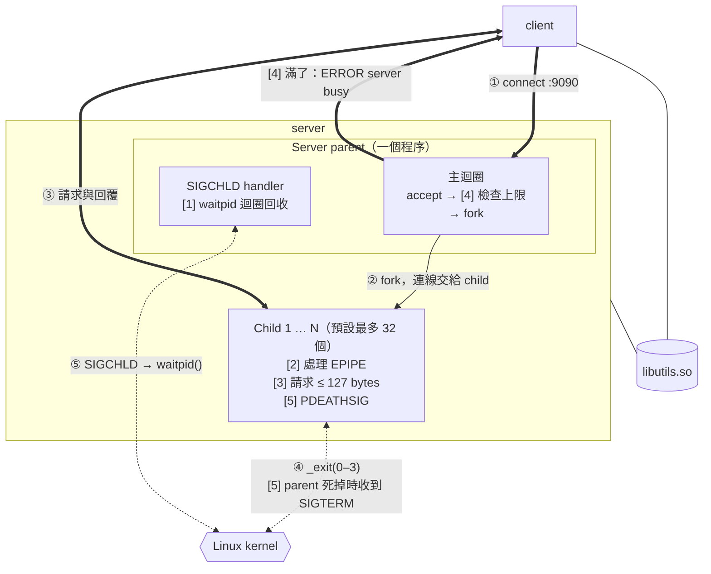
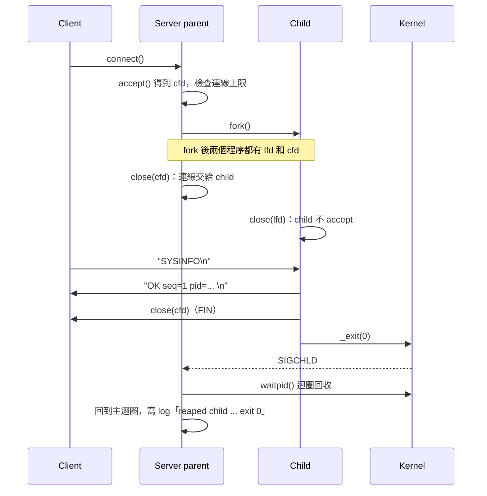

# 系統設計說明（System Design Explanation）

[← 回到 README](../README.md) ・ [關鍵原始碼說明](key-source.md) ・ [執行截圖](screenshots.md) ・ [稽核討論](audit.md)

## 1. 應用情境與目標

管理多台 Linux 主機時，常需要快速知道每台主機的負載和記憶體狀況。主機上跑 **server**，其他人不用登入主機，用 **client** 就能查詢一次，或連續觀察幾秒鐘的變化。

| 目標 | 設計上的對應 |
|---|---|
| 多個 client 同時查詢，彼此不影響 | 每條連線 `fork()` 一個 child，一個 child 出錯不影響 parent 和其他連線 |
| 遇到異常不當掉、不留垃圾 | 5 個穩健機制，處理程序、連線、輸入、資源四類異常 |
| 每個保護機制都看得到效果 | 每個機制都能用參數關閉，實際比較有無機制的差異 |
| 出問題時能追查 | 兩層 Debug：編譯期決定有沒有 debug 程式碼，執行期決定印多少 |

## 2. 系統架構

**圖例：** 粗線是 TCP 上的資料，細實線是 `fork()`，虛線是和 kernel 之間的互動（程序結束、訊號、回收），沒有箭頭的線是動態連結。①～⑤ 是一條連線的先後順序；[1]～[5] 是[第 5 節](#5-穩健性設計)的穩健機制，標在負責它的程序上。

### 程序模型（Process Model）

| 角色 | 職責 | 不做的事 |
|---|---|---|
| **Parent** | `accept()`、檢查連線上限、`fork()`、回收 child、記錄 log | 不讀 client 的資料；只有在達上限時寫一行 `ERROR server busy` |
| **Child** | 讀一行請求、驗證、回覆、`_exit(原因代碼)` | 不 accept（一 fork 就關掉 listening socket） |

整個專案沒有使用 thread。

### 資料流（Data Flow）

連線建立後，請求與回應只在 **client 和 child 之間**傳送。child 結束時 kernel 送出 **SIGCHLD**，parent 用 **`waitpid()`** 回收並記錄 exit code，不留下殭屍程序。

### 共用函式庫（Shared Library）

client 和 server 都動態連結 **`libutils.so`**：logger、`write_all`、`read_line`、系統資訊擷取與格式化。回應的格式由同一個 `sysinfo_format()` 產生，兩邊不會不一致。

## 3. 執行流程

兩個 `close()` 讓每條連線只有一個程序持有：parent 只留 listening socket，child 只留自己的連線。[稽核討論](audit.md)實測服務 50 個 client 前後，parent 的 fd 都是 5 個，child 也只持有自己那條連線。

### 請求與回應

| Client 送出 | Server 回覆 |
|---|---|
| `SYSINFO` | 一行 `OK seq=1 pid=... host=... up=... load=... mem_avail=... procs=...` |
| `WATCH <count> <ms>` | 每隔 `<ms>` 毫秒一行，共 `<count>` 行 |
| 錯誤的請求 | 一行 `ERROR <原因>`，然後關閉 |

一條連線只處理一個請求。回覆裡的 `pid=` 是處理這條連線的 child，抓包或 client 輸出都能直接看出是哪個程序服務的。

### Parent 主迴圈

parent 重複「**輸出回收紀錄 → `accept()` → 檢查上限 → `fork()`**」。`accept()` 被 SIGCHLD 打斷時回傳 `EINTR`，parent 回到迴圈開頭，先把剛回收的 child 寫進 log 再繼續等待。

### Child 處理請求

child 讀一行請求（最多 127 bytes），判斷是 `SYSINFO`、`WATCH` 還是錯誤，回覆後結束。exit code 說明結束原因，parent 回收時寫進 log：

| exit code | 原因 |
|---|---|
| 0 | 請求處理完成 |
| 1 | I/O 錯誤 |
| 2 | 請求被拒絕（太長、未知指令、參數錯誤） |
| 3 | client 已經離開 |

## 4. 雙層 Debug

| 層級 | 誰決定 | 效果 |
|---|---|---|
| 編譯期 | `make`（`-DENABLE_DEBUG`）或 `make release` | release 版的 debug 程式碼和字串整個被拿掉，執行時零成本 |
| 執行期 | `-d 0/1/2` | 0 只有一般訊息，1 加上程式流程（附 `file:line`），2 再加上請求和回覆的 hex dump |

兩層缺一不可：正式上線用 release 版，完全沒有額外負擔；開發時用 debug 版，需要時才用 `-d` 打開，不用重新編譯。

## 5. 穩健性設計

5 個機制處理四類異常，每個機制都能用參數關閉，比較有無機制的差異。

| 異常類型 | 會發生什麼 | 機制 | 關閉參數 |
|---|---|---|---|
| 程序：child 結束沒人收 | 殭屍程序佔滿 process table | [1] SIGCHLD handler + `waitpid` 迴圈 | `--no-sigchld` |
| 程序：parent 被 `kill -9` | child 變成孤兒，沒人管理 | [5] `PR_SET_PDEATHSIG` | `--no-pdeathsig` |
| 連線：client 中途離開 | child 寫入時被 SIGPIPE 殺掉 | [2] 忽略 SIGPIPE，處理 `EPIPE` | `--no-sigpipe` |
| 輸入：不換行的超長請求 | child 記憶體無限長大 | [3] 請求最多 127 bytes | `--no-validate` |
| 資源：大量或閒置連線 | 無限多個 child | [4] 連線上限，超過由 parent 直接拒絕 | `--no-limit` |

**[1] 和 [5] 是一組：** 殭屍是「child 死了、parent 沒收」，孤兒是「parent 死了、child 還在」。兩個機制合起來，保證 child 的生命週期一定跟著 parent。

實測對照見 [README 6.2](../README.md#62-test_robustness五組-withwithout-對照)。

## 6. 設計取捨與限制

| 決定 | 好處 | 代價 |
|---|---|---|
| 每條連線 fork 一個 child | 隔離性好，一個 child 當掉不影響其他連線；程式簡單 | 每條連線一個程序，比 thread 耗資源，所以用 [4] 限制數量（預設 32） |
| 請求和回應用一行純文字 | 抓包時直接讀得懂，用 `telnet` 或 `nc` 也能測 | 傳數字比二進位格式多幾個 bytes |
| 一條連線只處理一個請求 | child 的流程單純，處理完就結束 | 每次查詢都要重新做三向交握 |
| signal handler 只記錄，log 由主迴圈印 | 避免在 handler 裡呼叫不安全的 `printf()` | 回收紀錄可能延後到下一次 `accept()` 返回才印出 |

**其他限制：** 只支援 Linux 與 IPv4；沒有加密與身分驗證，連得上 server 的人都能讀到系統資訊。
