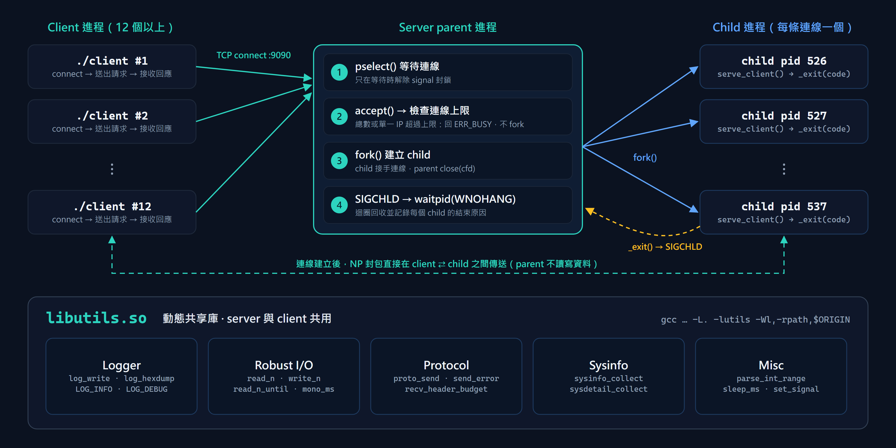
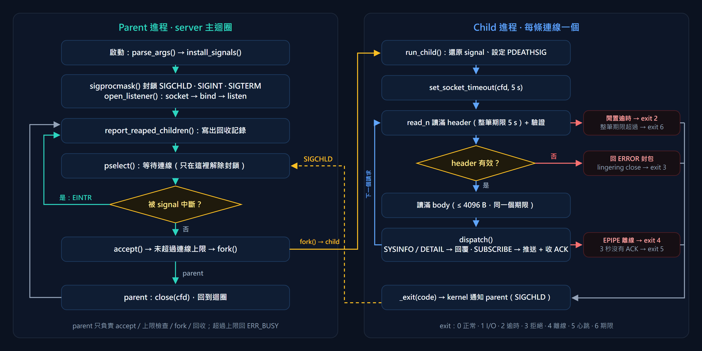
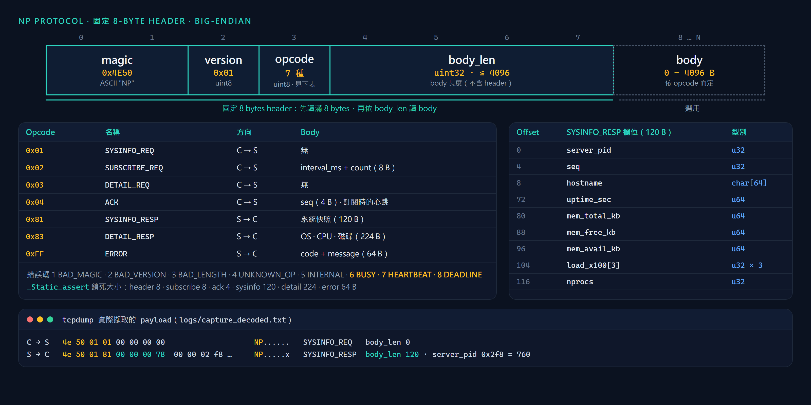

# 系統設計說明（System Design Explanation）

[← 回到 README](../README.md) ・ [關鍵原始碼說明](key-source.md) ・ [執行截圖](screenshots.md)

## 1. 應用情境與目標

管理多台 Linux 主機時，維運人員或監控程式常需要快速知道每台主機的負載、記憶體和磁碟狀況。NP SysInfo 把這件事做成輕量的網路服務：主機上跑 `server`，其他人不用登入主機，就能用 `client` 查詢一次、持續訂閱，或取得 OS、CPU、磁碟的詳細資訊。

設計目標：

- 每個 client 由獨立的程序服務，一條連線出問題不影響其他連線。
- 異常情況要能偵測、處理並留下紀錄，不能當掉或卡住。
- 每個穩健機制都能單獨關閉，用實際執行比較有無機制的差異。

## 2. 系統架構



| 元件 | 職責 |
|---|---|
| Client | 連線、送出請求、顯示結果；訂閱中斷線時自動重連 |
| Server parent | 只負責等待連線、`accept()`、檢查連線上限、`fork()` 和回收 child |
| Server child | 一個 child 服務一條連線，處理該連線的所有請求，結束時用 exit code 表示原因 |
| `libutils.so` | client 和 server 共用的 log、完整讀寫、協定收送與系統資訊 |

連線建立後，資料只在 client 和 child 之間傳送。parent 只有在連線數達上限或 fork 失敗時，才會回傳一個錯誤封包。

每個 child 都是獨立程序，所以一個 child 被殺掉不會影響 parent 和其他連線。測試中 3 個 child 被 SIGPIPE 殺掉後，parent 仍能服務新的 client。整個專案沒有使用 thread。

## 3. 執行流程



**Parent：**

1. 解析參數，用 `sigaction` 安裝 signal handler。
2. 封鎖 SIGCHLD、SIGINT、SIGTERM，建立 listening socket。
3. 寫出已回收 child 的紀錄。
4. 用 `pselect()` 等待連線，只在等待期間解除 signal 封鎖。被 signal 中斷就回到第 3 步。
5. `accept()` 後檢查連線上限，超過就回 `ERR_BUSY`，不 fork。
6. `fork()` 出 child，parent 關閉該連線的 fd，回到第 3 步。

**Child：**

1. 關閉 listening socket，還原 signal 設定，設定 `PR_SET_PDEATHSIG`。
2. 設定 socket 逾時。
3. 讀滿 8 bytes 的 header 並驗證，再讀滿 body。
4. 依 opcode 回應查詢、延伸資訊或訂閱推送。
5. 重複第 3、4 步直到連線結束，再以 `_exit(code)` 結束，kernel 會送 SIGCHLD 通知 parent 回收。

**一次查詢的訊息流程：**

```text
client --SYSINFO_REQ (8 bytes)--------------------------> server child
client <--SYSINFO_RESP (8-byte header + 120-byte body)--- server child
```

## 4. 通訊協定設計



| 設計 | 原因 |
|---|---|
| 固定 8 bytes 的 header | 先讀滿 header 就知道後面還有多少資料，能解決 TCP 拆包與黏包 |
| magic `0x4E50` | 能辨識不屬於本協定的資料，在 tcpdump、Wireshark 中直接顯示為 `NP` |
| `body_len` 上限 4096 | 擋下謊報的長度，避免配置大量記憶體 |
| 多位元組欄位用 big-endian | 不同平台的解讀結果一致 |
| load average 用乘以 100 的整數 | 避免在網路上傳浮點數 |
| `_Static_assert` 鎖定結構大小 | 結構大小不對時直接編譯失敗 |

`tests/np_client_win.c` 只依照協定規格撰寫，沒有共用 `protocol.h` 或 `client.c` 的程式碼，編譯成 Windows 程式後能連到 Linux 上的 server，證明協定規格是完整的。完整欄位表見 [README 第 4 節](../README.md#4-通訊協定固定-8-byte-header)。

## 5. 共用函式庫 `libutils.so`

| 模組 | 內容 |
|---|---|
| Logger | 帶時間與 PID 的 log、雙層 Debug、hex dump |
| Robust I/O | `read_n`、`write_n`、`read_n_until`、socket 逾時 |
| 協定 | 封包收送、header 驗證、錯誤碼文字 |
| 系統資訊 | 主機、負載、記憶體、OS、CPU、磁碟資訊的擷取與位元組序轉換 |
| 其他 | 整數參數解析、可續睡的 sleep、`set_signal` |

函式庫以 `-fPIC -shared` 編譯，共匯出 27 個符號，client 和 server 都用 `-lutils` 動態連結。兩端共用同一份協定程式碼，所以不會發生兩邊格式不一致的問題。`-Wl,-rpath,'$ORIGIN'` 讓執行檔到自己所在的資料夾找函式庫，從任何目錄啟動都可以。

## 6. 雙層 Debug

| 層級 | 控制方式 | 效果 |
|---|---|---|
| 編譯期 | `make`（帶 `-DENABLE_DEBUG`）或 `make release` | release 版把 `LOG_DEBUG`、`LOG_HEXDUMP` 展開成 `((void)0)`，執行檔裡 debug 專用字串為 0 個 |
| 執行期 | `-d 0/1/2` | 0 只有一般訊息，1 加上流程與 `file:line`，2 再加上封包解碼與 hex dump |

## 7. 穩健性設計

異常情況分成五類，由 9 個機制處理，共 10 組 With/Without 情境。完整實測結果見 [README 7.2](../README.md#72-test_robustness十組-withoutwith-對比)。

| 類別 | 異常情況 | 機制 |
|---|---|---|
| 程序 | child 結束後沒人回收 | [1] SIGCHLD handler + `waitpid(WNOHANG)` |
| 程序 | 多個 SIGCHLD 合併成一個 | [1b] handler 內用迴圈回收 |
| 程序 | parent 被 `kill -9` | [9] `PR_SET_PDEATHSIG` |
| 連線 | 寫入已離線的 client | [2] 忽略 SIGPIPE，處理 `EPIPE` |
| 連線 | server 重啟或當機 | [8] client 指數退避重連 |
| 資料 | 亂碼、偽造長度 | [3] header 驗證 |
| 資料 | TCP 拆包、黏包 | [6] 依長度完整讀取 |
| 對方不動或太慢 | 連上後不送資料 | [3] `SO_RCVTIMEO` / `SO_SNDTIMEO` |
| 對方不動或太慢 | 每 3 秒才送 1 byte | [5] 整筆請求期限 |
| 對方不動或太慢 | 訂閱中的 client 被凍結 | [7] 心跳 ACK |
| 資源 | 一台主機占滿連線 | [4] 總連線上限與每個位址的上限 |

## 8. 設計亮點

1. **parent 和 child 職責分離。** parent 不處理請求，child 出問題時影響範圍只有自己那條連線。
2. **消除 signal 的競爭條件。** signal 平時被封鎖，只在 `pselect()` 等待時才原子性地解除。這是實測發現的問題，修正前 12 個連線只記錄到 5 筆回收。
3. **Signal handler 只做安全的事。** handler 只回收 child 並把結果存入 ring buffer，log 由主迴圈輸出。
4. **結束原因看得到。** child 用 exit code 0 到 6 表示結束原因，parent 回收時寫進 log，可以追到每條連線為什麼結束。
5. **每個機制都能驗證。** 每個穩健機制都有關閉參數，`tests/test_robustness.c` 自動比較有無機制的差異，共 27 項檢查。

## 9. 設計取捨與限制

| 項目 | 取捨或限制 | 因應方式 |
|---|---|---|
| 每條連線一個程序 | 隔離性好，但每條連線都要一個程序的資源 | 預設最多 128 個 child，可用 `-m` 調整 |
| 單一 IP 上限 | 預設沒有限制，一台主機可占滿全部名額 | 啟動時加 `--max-per-ip` |
| 傳輸安全 | 明文傳輸、沒有身分驗證 | 可加 TLS 或 SSH tunnel、token、防火牆限制 |
| 平台 | 只支援 Linux 與 IPv4 | 用到 `prctl`、`sysinfo(2)`、`/proc` |
| Real Test | 只用一台實體電腦，壞網路為模擬 | 詳見 [README 7.5](../README.md#75-test_real單機-real-test) |

## 10. 驗證方式

| 測試 | 驗證內容 | 結果 |
|---|---|---|
| `make test-concurrent` | 12 個 client 同時連線 | 9/9 通過 |
| `make test-robust` | 10 組 With/Without 情境 | 27/27 通過 |
| `make test-debug` | 編譯期與執行期 Debug | 15/15 通過 |
| `make test-capture` | tcpdump 抓包與協定解碼 | 11/11 通過 |
| `make test-real` | Windows ↔ WSL2 與模擬壞網路 | 19/19 通過 |
| `make audit` | 靜態分析、sanitizer、負載、惡意 server | 25/25 通過 |

稽核通過的項目、已修正的問題和仍存在的風險，見 [README 7.6](../README.md#76-test_audit稽核討論)。
