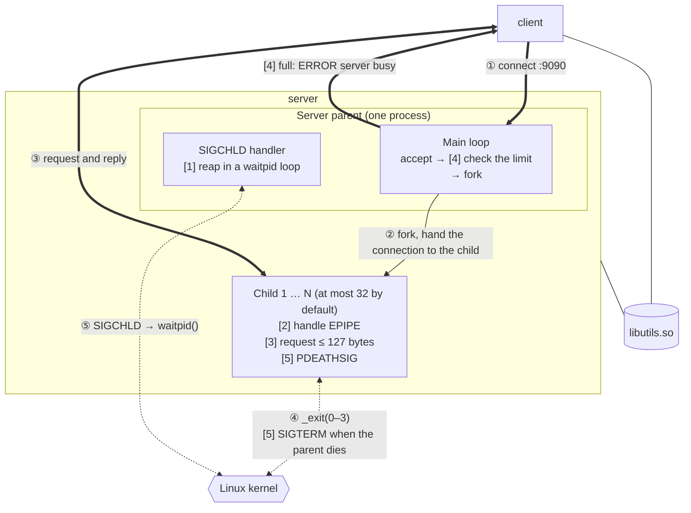
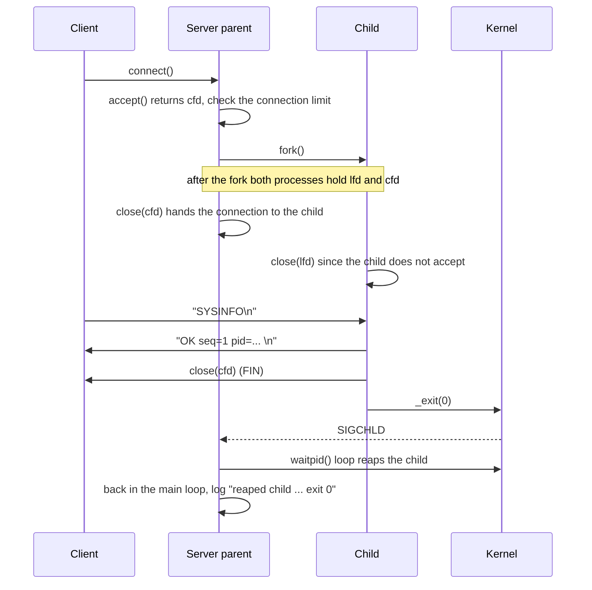

# System Design Explanation

[← Back to README](../README.md) · [Key Source Code](key-source.md) · [Execution Screenshots](screenshots.md) · [Auditing Discussion](audit.md)

## 1. Use Case and Goals

When you manage several Linux hosts, you often need a quick look at each host's load and memory. With the **server** running on a host, other people can use the **client** to query it once, or watch it change over a few seconds, without logging in to the host.

| Goal | How the design meets it |
|---|---|
| Several clients query at once without affecting each other | Each connection gets its own `fork()`ed child, and an error in one child does not affect the parent or the other connections |
| Do not crash on failures and leave nothing behind | 5 robustness mechanisms that handle four kinds of failure: processes, connections, input and resources |
| The effect of every protection can be seen | Each mechanism can be turned off with a flag, so the difference with and without it can actually be compared |
| Problems can be traced | Two-level debug: compile time decides whether there is any debug code, runtime decides how much is printed |

## 2. System Architecture

**Legend:** Thick lines are data over TCP, thin solid lines are `fork()`, dashed lines are interactions with the kernel (process exit, signals, reaping), and lines without arrows are dynamic linking. ① to ⑤ give the order of events on one connection; [1] to [5] are the robustness mechanisms of [Section 5](#5-robustness-design), each placed on the process responsible for it.

### Process Model

| Role | Responsibilities | What it does not do |
|---|---|---|
| **Parent** | `accept()`, check the connection limit, `fork()`, reap children, write the log | Does not read client data; writes only the one line `ERROR server busy` when the limit is reached |
| **Child** | Read one request line, validate it, reply, `_exit(reason code)` | Does not accept (it closes the listening socket right after the fork) |

The project uses no threads anywhere.

### Data Flow

Once the connection is set up, requests and replies travel only **between the client and the child**. When the child exits, the kernel sends **SIGCHLD**, and the parent reaps the child with **`waitpid()`** and records its exit code, so no zombie processes are left.

### Shared Library

The client and the server both link **`libutils.so`** dynamically: the logger, `write_all`, `read_line`, and system information collection and formatting. The server's reply is produced by `sysinfo_format()`, and the client reads it back with `read_line()` and prints it as it is.

## 3. Execution Flow

The two `close()` calls leave each connection held by exactly one process: the parent keeps only the listening socket, and the child keeps only its own connection. In the [auditing discussion](audit.md), the parent held 5 fds both before and after serving 50 clients, and each child held only its own connection.

### Requests and Replies

| Client sends | Server replies |
|---|---|
| `SYSINFO` | One line `OK seq=1 pid=... host=... up=... load=... mem_avail=... procs=...` |
| `WATCH <count> <ms>` | One line every `<ms>` milliseconds, `<count>` lines in total |
| A bad request | One line `ERROR <reason>`, then the connection is closed |

Each connection handles one request. The `pid=` in the reply is the child that handles this connection, so a packet capture and the client's output both show directly which process served it.

### Parent Main Loop

The parent repeats "**print the reap records → `accept()` → check the limit → `fork()`**". When SIGCHLD interrupts `accept()`, it returns `EINTR`; the parent goes back to the top of the loop, first writes the children it just reaped to the log, and then waits again.

### Child Request Handling

The child reads one request line (at most 127 bytes), decides whether it is `SYSINFO`, `WATCH` or an error, replies, and exits. The exit code gives the reason it ended, and the parent writes it to the log when it reaps the child:

| exit code | Reason |
|---|---|
| 0 | Request served |
| 1 | I/O error |
| 2 | Request rejected (too long, unknown command, bad arguments) |
| 3 | The client has left |

## 4. Two-Level Debug

| Level | Who decides | Effect |
|---|---|---|
| Compile time | `make` (`-DENABLE_DEBUG`) or `make release` | The release build has no debug code or strings at all, so it costs nothing at runtime |
| Runtime | `-d 0/1/2` | 0 only normal messages, 1 adds the program flow (with `file:line`), 2 also adds hex dumps of the requests and replies |

Both levels are needed: the release build runs in production with no extra cost, and the debug build is used during development, where `-d` turns on more detail when needed, without a rebuild.

## 5. Robustness Design

5 mechanisms handle four kinds of failure. Each mechanism can be turned off with a flag, so the difference with and without it can be compared.

| Kind of failure | What happens | Mechanism | Flag to turn it off |
|---|---|---|---|
| Process: a finished child is never reaped | Zombie processes fill the process table | [1] SIGCHLD handler + `waitpid` loop | `--no-sigchld` |
| Process: the parent gets `kill -9` | The children become orphans with nobody managing them | [5] `PR_SET_PDEATHSIG` | `--no-pdeathsig` |
| Connection: the client leaves midway | The child is killed by SIGPIPE when it writes | [2] Ignore SIGPIPE and handle `EPIPE` | `--no-sigpipe` |
| Input: an oversized request with no newline | The child's memory grows without limit | [3] Requests capped at 127 bytes | `--no-validate` |
| Resources: many or idle connections | Unlimited child processes | [4] Connection limit; above it the parent rejects the client itself | `--no-limit` |

**[1] and [5] form a pair:** A zombie is "the child died and the parent never collected it", an orphan is "the parent died and the child is still running". Together, the two mechanisms make sure a child's lifetime always follows its parent.

The measured comparisons are in [README 6.2](../README.md#62-test_robustness-five-withwithout-comparisons).

## 6. Design Tradeoffs and Limitations

| Decision | Benefit | Cost |
|---|---|---|
| Fork one child per connection | Good isolation: a crashed child does not affect the other connections; the code stays simple | One process per connection costs more than a thread, so [4] caps the number (32 by default) |
| Requests and replies are one line of plain text | Easy to read in a packet capture, and easy to test with `telnet` or `nc` | Numbers sent as text take a few more bytes than a binary format |
| One request per connection | The child's flow is simple: it exits when it is done | Every query needs a new three-way handshake |
| The signal handler only records; the main loop writes the log | Avoids calling the unsafe `printf()` in a handler | A reap record may not be printed until the next time `accept()` returns |

**Other limitations:** Linux and IPv4 only; no encryption or authentication, so anyone who can reach the server can read its system information.
